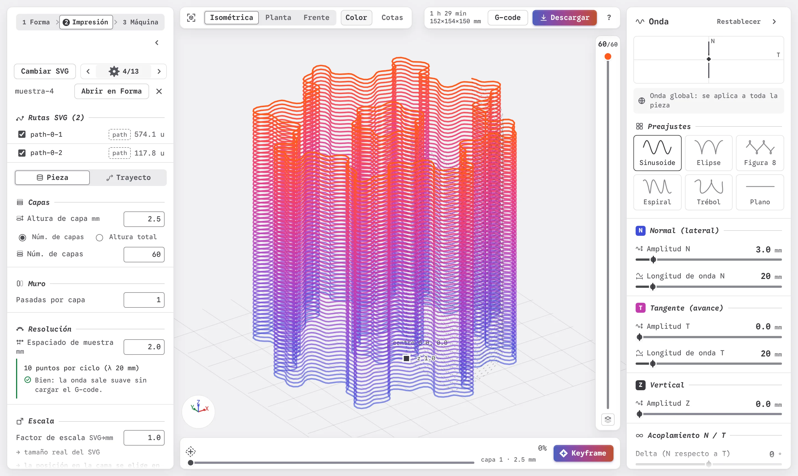
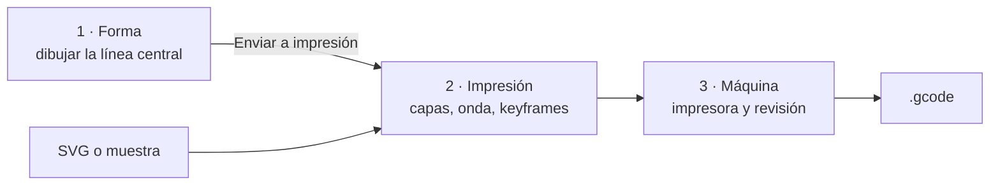
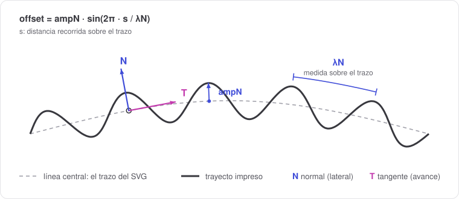
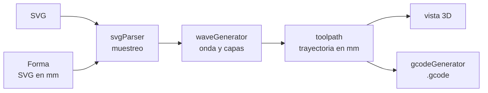

<p align="center">
  <picture>
    <source media="(prefers-color-scheme: dark)" srcset="public/favicon.white.ico">
    
  </picture>
</p>

<h1 align="center">barrocode</h1>

barrocode convierte un dibujo SVG en G-code para impresoras 3D de arcilla. El trazo del dibujo es la línea central de la pared; barrocode lo ondula, apila las capas y escribe el archivo que lee la impresora. Se pronuncia como *barroco*.

Funciona en el navegador. No hay que instalar nada y los archivos no salen de tu computador.

**Abrir la app:** <https://cranmellar.github.io/barrocode/>



## Qué puedes hacer

- Cargar un SVG, usar una de las 13 muestras o dibujar la forma en el espacio *Forma*.
- Ondular la pared hacia los lados (N), hacia adelante y atrás (T) y en altura (Z).
- Cambiar la onda, la escala, el giro y el centro a lo largo de la altura con keyframes.
- Ver en 3D exactamente lo que se va a imprimir, con el tiempo estimado y el tamaño.
- Elegir tu impresora y revisar antes de exportar si la pieza cabe en la cama.
- Descargar el G-code.

## Cómo se usa

La app tiene tres espacios de trabajo, en el selector de arriba a la izquierda:



1. **Forma** (opcional). Genera lóbulos, polígonos, estrellas o superfórmulas a un diámetro exacto en mm, y edita sus nodos. También puedes importar un SVG para corregirlo.
2. **Impresión**. Elige los trayectos que se imprimen, la altura de capa, el número de capas y la onda. Agrega keyframes (`K`) si la pieza cambia con la altura.
3. **Máquina**. Elige el perfil de tu impresora. La revisión avisa si la pieza se sale de la cama, si la capa no corresponde a la boquilla o si falta algo en las plantillas de inicio y fin.

Después pulsa **Descargar**. La sesión se guarda en el navegador y se puede recuperar al volver.

La guía completa, con cada parámetro y atajo, está en [docs/usage.md](docs/usage.md). En la app, el botón `?` abre una ayuda rápida.

## La onda

Cada punto del trayecto se desplaza desde la línea central según la distancia recorrida sobre el trazo:



```text
punto(s) = centro(s)
         + N(s) · ampN · sin(2π·s/λN + δ + φ)
         + T(s) · ampT · sin(2π·s/λT + φ)
         + Z    · ampZ · sin(2π·s/λZ + φZ + φ)
```

| Símbolo | Qué es |
|---|---|
| `s` | Distancia recorrida sobre el trazo, en mm. |
| `N(s)`, `T(s)` | Normal (hacia el lado) y tangente (hacia adelante) del trazo en ese punto. |
| `ampN`, `ampT`, `ampZ` | Amplitud de cada onda, en mm. |
| `λN`, `λT`, `λZ` | Longitud de onda, medida sobre el trazo y no sobre un eje recto. |
| `δ` | Desfase entre N y T. Con longitudes iguales, `0°` da una línea y `90°` una elipse. |
| `φ` | Fase de la capa: un desfase inicial más un desfase por capa. El desfase por capa produce torsiones y espirales. |

Tres ajustes automáticos hacen que la onda se pueda imprimir:

- En un contorno cerrado, la longitud de onda se ajusta un poco para que entre un número entero de ciclos. Así la onda cierra sin escalón en la costura.
- Las curvas más cerradas de lo que la onda puede seguir se redondean antes de ondular, con un radio de unas 1,25 veces la amplitud N. Sin eso, la onda se enrolla hacia adentro y salta hacia afuera.
- Con onda Z, la primera capa no baja de su altura y cada punto queda al menos media capa por encima del punto de abajo.

## Pensado para arcilla

| Qué hace | Por qué |
|---|---|
| No retrae. | Cortar el flujo de arcilla deja huecos y burbujas. |
| Sube a la capa siguiente mientras imprime. | En un contorno cerrado, la boquilla sube durante el último tramo de la vuelta. No hay una subida vertical en la costura. |
| Salta sobre los cruces. | Donde el trayecto se cruza a sí mismo, la boquilla pasa en parábola por encima del cordón que ya está. |
| Viaja en arco y por encima. | Entre trayectos sube 2 mm sobre lo más alto impreso y rodea la pieza en vez de cruzarla. |
| Puede pausar y cebar. | Una pausa (`G4`) al inicio y una línea de cebado junto a la primera capa estabilizan el flujo. |
| Termina arriba y detenido. | Sube 10 mm por encima de la pieza (o de la Z de seguridad, si es más alta), espera el último movimiento y apaga los motores, extrusor incluido. |

## Antes de imprimir

- **Tamaño.** Si el SVG declara su tamaño en unidades físicas (`width="100mm"`, `in`, `pt`…), se imprime a ese tamaño. Si no, 1 unidad SVG = 1 mm. Para píxeles a 96 dpi, usa un factor de escala de `0.2645`. Las formas de *Forma* y las muestras ya vienen en mm.
- **Cama y origen.** El perfil de arcilla por defecto pone el centro de la pieza en X 0, Y 0, como en las impresoras delta. Si tu impresora tiene el origen en una esquina, elige ese perfil en *Máquina* o pulsa *Centrar en la cama*. Una marca roja en la barra superior avisa si algo se sale de la cama.
- **Extrusión.** `E` es absoluta (`M82`) y crece con el largo de cada movimiento, subidas incluidas. En arcilla, `E` = largo × multiplicador: calibra el multiplicador para tu bomba, pistón o tornillo, o desactiva *Generar valores E* si la máquina controla el flujo aparte.
- **Perfiles.** Los perfiles de impresora usan cifras de catálogo que no se han probado en cada máquina. Compruébalos en la tuya.
- **Encabezado.** El G-code empieza con los parámetros usados, incluidos los keyframes. Revísalo antes de imprimir.

## G-code generado

Extracto de uno de los archivos de referencia de las pruebas:

```gcode
; ============================================================
; barrocode — Lissajous G-code Generator
; ============================================================
; Machine                : Arcilla · origen al centro · RepRap / Duet
; Box X 0.000…101.000  Y 0.000…101.000  Z 1.000…30.000 mm
; Lissajous amp N / T   : 2 / 0 mm
; Layer height           : 2.5 mm
; Soft join              : true (transition 10 mm)
; Z-hop height / radius  : 2.5 / 3 mm
; ...
G21       ; mm units
G90       ; absolute positioning
M82       ; absolute extrusion
G92 E0    ; reset E

G1 Z20.000 F1500  ; safe Z

; ===== Layer 1 / 2   Z = 1.000 mm =====
;LAYER_CHANGE
;Z:1.000
;LAYER:0
G1 X0.000 Y50.000 F1500  ; travel to start
G1 Z1.000 F1500  ; descend
G1 X2.000 Y51.176 E0.116 F600
G1 X4.000 Y51.902 E0.222 F600
...
; ===== End =====
G1 Z30.000 F1500  ; final lift
M400  ; wait for the last move to finish
M107  ; auxiliary output off (auger or air valve on the fan pin)
M84   ; disable motors, extruder included
```

Las marcas `;LAYER_CHANGE` y `;LAYER:` permiten ver las capas en los visores de PrusaSlicer y Cura.

## Limitaciones conocidas

- Los elementos ocultos con `visibility:hidden` se imprimen. Usa `display:none` o bórralos.
- Las puntas muy agudas pierden largo al redondearse con amplitudes grandes (una punta de 30° pierde unos 15 mm con amplitud 3).
- `E` no compensa el grosor real del cordón: con onda Z, el hueco con la capa de abajo varía entre la mitad y más de una vez y media la altura de capa.
- En *Impresión* no hay deshacer. *Forma* sí tiene `Ctrl+Z`.
- Solo para computador de escritorio, en un navegador actual.

## Desarrollo

Requiere Node.js 18 o superior (la integración continua usa Node 24).

```bash
npm install
```

```bash
npm run dev
```

Abre la dirección que muestra la terminal, normalmente `http://localhost:5173`.

| Comando | Qué hace |
|---|---|
| `npm run dev` | Servidor de desarrollo de Vite. |
| `npm test` | Pruebas con Vitest. `npm test -- -u` actualiza los G-code de referencia. |
| `npm run build` | Revisa los tipos con `tsc` y genera la app estática en `dist/`. |
| `npm run preview` | Sirve `dist/` en local. |

`dist/` usa rutas relativas: funciona en cualquier servidor estático y en una subcarpeta. Abierto directamente desde el disco (`file://`) no funciona en Chromium, que bloquea los scripts de tipo módulo; sírvelo con `npm run preview` o cualquier servidor local.

Cada pull request corre las pruebas y el build ([ci.yml](.github/workflows/ci.yml)). Cada push a `main` los repite y publica la app en GitHub Pages ([deploy.yml](.github/workflows/deploy.yml)). Si una prueba falla, no se publica.

Las pruebas cubren la lógica de `src/lib/` y `src/shaper/lib/`: que el G-code no extruya en saltos largos ni baje sobre la pieza, que los viajes pasen por encima de lo impreso, que el G-code coincida con la vista 3D, los archivos de referencia, la onda, los keyframes y la geometría de *Forma*.

### Cómo está hecho



La vista 3D y el G-code leen la misma trayectoria, así que muestran lo mismo. El detalle está en [docs/architecture.md](docs/architecture.md).

Usa Vite 5, React 18 y TypeScript estricto, Canvas 2D para la vista 3D y *Forma*, y Vitest para las pruebas. No usa librerías de interfaz: los estilos están en `src/index.css` y la tipografía es GSCode.

## Documentación

| Documento | Contenido |
|---|---|
| [docs/usage.md](docs/usage.md) | Guía de uso: cada espacio de trabajo, parámetro y atajo. |
| [docs/architecture.md](docs/architecture.md) | Cómo pasa el SVG a G-code dentro del código. |
| [docs/fabrication-notes.md](docs/fabrication-notes.md) | Decisiones de fabricación con arcilla. |
| [docs/marco-teorico.md](docs/marco-teorico.md) | Referentes teóricos: ornamento, simetría, forma orgánica, materia, accidente programado. |
| [docs/research-notes.md](docs/research-notes.md) | Ideas de diseño y fabricación en exploración. |
| [docs/shaper-plan.md](docs/shaper-plan.md), [docs/maquina-plan.md](docs/maquina-plan.md) | Planes y registro de *Forma* y *Máquina*. |
| [docs/altura-plan.md](docs/altura-plan.md) | Propuesta: forma que cambia con la altura. Sin implementar. |
| [pendientes.md](pendientes.md) | Tareas pendientes, por prioridad. |
| [CLAUDE.md](CLAUDE.md) | Manual para trabajar en el código con Claude Code, con el estado actual del proyecto. |

## Licencia

[MIT](LICENSE) © 2026 Cristián Mella. Puedes usar, modificar y redistribuir el código manteniendo el aviso de copyright. El G-code y las piezas que hagas con barrocode son tuyos.
