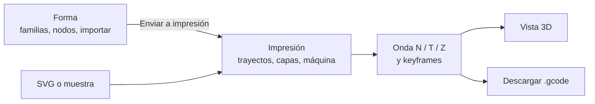
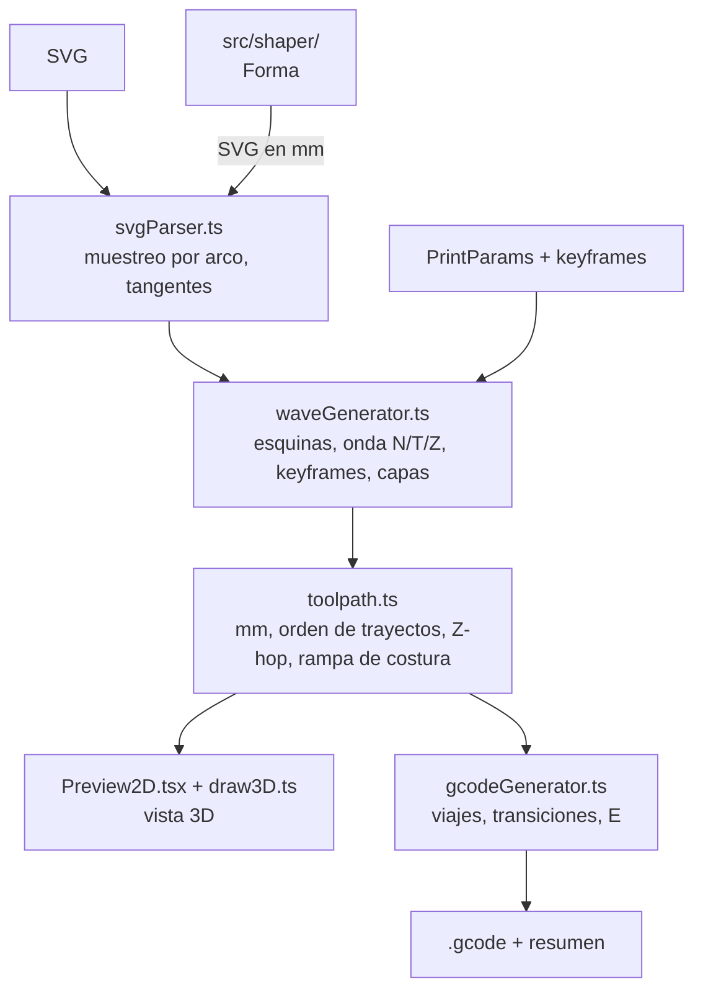

# BarroCode

Herramienta web para convertir curvas `.svg` en G-code para impresoras 3D de arcilla. Se pronuncia como *barroco*.

BarroCode toma un dibujo vectorial como línea central de la pared, la muestrea a lo largo de su longitud de arco y desplaza cada punto con una onda de Lissajous local. Las capas se apilan con uniones suaves, sin retracción, y la trayectoria se exporta como G-code en milímetros. Todo corre en el navegador: no hay servidor ni instalación.

**Abrir la app:** <https://cranmellar.github.io/barrocode/>

## Qué Hace

- **Dibuja o importa la pieza.** Carga un SVG (arrastrándolo a la ventana o con *Cargar SVG*), usa una de las muestras integradas o genera la forma en el espacio *Forma*: lóbulos, polígonos y estrellas redondeadas o superfórmula, a un diámetro exacto en mm, con edición de nodos.
- **Ondula la pared.** Una onda sobre la normal (N), otra sobre la tangente (T) y, opcionalmente, una oscilación vertical (Z), medidas en mm sobre el arco del trayecto.
- **Anima la pieza en altura.** Keyframes sobre la línea de tiempo cambian la onda, la escala, el giro y el centro a lo largo de la impresión, con transición recta o suave.
- **Muestra lo que se imprime.** La vista 3D dibuja la misma trayectoria que se escribe en el G-code, con tiempo estimado, tamaño de la pieza y filtro por capas.
- **Exporta G-code para arcilla.** Sin retracción, con subida a la capa siguiente mientras se imprime, saltos en Z sobre los cruces, viajes en arco por encima de la pieza, pausa y cebado opcionales.

## Flujo De Uso



1. Crea la forma en *Forma* o carga un SVG en *Impresión*.
2. Revisa los trayectos detectados: actívalos, desactívalos o cambia su onda uno a uno.
3. Ajusta capas, escala y posición (*Pieza*), unión de capas y viajes (*Trayecto*), velocidades y extrusión (*Máquina*).
4. Ajusta la onda en el panel derecho, con presets y una vista de la figura de Lissajous.
5. Añade keyframes (`K`) si la pieza debe cambiar con la altura.
6. Revisa la vista 3D y descarga el `.gcode`.

La sesión se guarda en el navegador y se puede restaurar al volver. La guía completa, con cada parámetro y atajo, está en [docs/usage.md](docs/usage.md); la app tiene además una ayuda rápida en el botón `?`.

## Cómo Funciona La Onda

Cada punto de la trayectoria es la línea central más tres oscilaciones:

```text
punto(s) = centro(s)
         + N(s) · ampN · sin(2π·s/λN + δ + φ)
         + T(s) · ampT · sin(2π·s/λT + φ)
         + Z    · ampZ · sin(2π·s/λZ + φZ + φ)
```

- `s` es la longitud de arco acumulada sobre el trayecto, en mm.
- `N(s)` y `T(s)` son la normal y la tangente unitarias en ese punto.
- `λN`, `λT` y `λZ` son longitudes de onda medidas sobre el arco, no sobre un eje recto.
- `δ` es el desfase entre N y T, y decide la figura: con longitudes iguales, `0°` da una línea y `90°` una elipse.
- `φ` es la fase de la capa: un offset inicial más un desfase por capa, que produce torsiones y espirales.

Algunos detalles que hacen la onda imprimible:

- **Costura cerrada.** En un trayecto cerrado la longitud de onda se ajusta levemente para que entre un número entero de ciclos, así la onda se encuentra consigo misma en la costura.
- **Esquinas redondeadas.** Las curvas más cerradas de lo que la onda puede seguir se redondean antes de ondular (radio ≈ 1,25 × amplitud N); sin eso, la onda forma bucles hacia dentro y saltos hacia fuera.
- **Piso en Z.** Con oscilación vertical, la primera capa no baja de su altura y cada punto queda al menos media capa sobre el punto de abajo.

## Pensado Para Arcilla

| Comportamiento | Por qué |
|---|---|
| Sin retracción | Cortar el flujo de arcilla deja huecos y burbujas. |
| Unión suave entre capas | En trayectos cerrados la boquilla sube a la capa siguiente durante el último tramo de la vuelta, imprimiendo, en vez de subir en vertical en la costura. |
| Z-hop parabólico en cruces | Donde la trayectoria se cruza a sí misma, la boquilla pasa por encima del cordón ya depositado. |
| Viajes en arco | Entre trayectos, la boquilla sube 2 mm sobre lo más alto impreso y viaja en arco concéntrico, sin arrastrar la pared. |
| Pausa y cebado | Un `G4` opcional al inicio y una línea de cebado junto a la primera capa estabilizan el flujo. |
| Subida final segura | Al terminar sube 10 mm sobre la pieza o sobre la Z de seguridad, lo que sea más alto. |

## Antes De Imprimir

- **Origen de la cama.** Por defecto el centro de la pieza va a X 0, Y 0, lo correcto en impresoras delta y otras con origen al centro. En una impresora con origen en una esquina, pon el centro de la cama en *Pieza → Escala y posición → Posición X / Y*; si no, media pieza queda en coordenadas negativas.
- **Escala.** Si el SVG declara su tamaño en unidades físicas (`width="100mm"`, `in`, `pt`…), se imprime a ese tamaño. Si no, 1 unidad SVG = 1 mm; para píxeles a 96 dpi usa un factor de escala de `0.2645`. Las formas de *Forma* llegan siempre en mm.
- **Extrusión.** `E` es absoluta (`M82`) y crece con la distancia recorrida: `E += distancia · multiplicador`. Calibra el multiplicador para tu bomba, pistón o tornillo, o desactiva *Generar valores E* si tu máquina controla el flujo aparte.
- **Revisa el encabezado.** El G-code empieza con un bloque de comentarios con los parámetros usados.

## G-code Generado

Extracto real de una de las pruebas de referencia:

```gcode
; ============================================================
; BarroCode — Lissajous G-code Generator
; ============================================================
; Lissajous amp N / T   : 2 / 0 mm
; Lissajous wl  N / T   : 20 / 20 mm
; Layer height           : 2.5 mm
; Soft join              : true (transition 10 mm)
; Print speed            : 600 mm/min
; Extrusion multiplier   : 0.05
; ...
G21       ; mm units
G90       ; absolute positioning
M82       ; absolute extrusion
G92 E0    ; reset E

G1 Z20.000 F1500  ; safe Z

; ===== Layer 1 / 2   Z = 1.000 mm =====
; Z-hop: 1 crossing(s) detected
; --- Layer 1, Path 1 ---
G1 X0.000 Y50.000 F1500  ; travel to start
G1 Z1.000 F1500  ; descend
G1 X2.000 Y51.176 E0.116 F600
G1 X4.000 Y51.902 E0.222 F600
...
; ===== End =====
G1 Z30.000 F1500  ; final lift
M84  ; disable motors
```

## Desarrollo

Requiere Node.js 18 o superior (CI usa Node 24).

```bash
npm install
```

```bash
npm run dev
```

Abre la URL que aparece en la terminal, normalmente `http://localhost:5173`.

| Comando | Para qué |
|---|---|
| `npm run dev` | Servidor de desarrollo de Vite |
| `npm test` | Pruebas con Vitest (`npm test -- -u` actualiza los G-code de referencia) |
| `npm run build` | Comprobación de tipos con `tsc` y build estático en `dist/` |
| `npm run preview` | Sirve `dist/` localmente |

El build usa rutas relativas, así que `dist/` funciona en cualquier servidor estático, en una subcarpeta o abierto directamente desde el disco.

Cada pull request pasa las pruebas y el build en GitHub Actions ([ci.yml](.github/workflows/ci.yml)). Cada push a `main` los repite y publica la app en GitHub Pages ([deploy.yml](.github/workflows/deploy.yml)); una prueba fallida bloquea la publicación.

Las pruebas cubren la lógica de `src/lib/` y `src/shaper/lib/`: invariantes de movimiento del G-code (sin extrusiones largas ni descensos sobre la pieza, viajes por encima de lo impreso, G-code igual a la vista previa), archivos `.gcode` de referencia, la onda, los keyframes y la geometría de *Forma*.

## Arquitectura



- `src/lib/svgParser.ts` sanea el SVG, lo inserta en un contenedor oculto y usa la API SVG del navegador para medir longitudes, puntos y transforms. Ignora lo que no se dibuja (`defs`, `clipPath`, `display:none`…).
- `src/lib/waveGenerator.ts` redondea esquinas, calcula la onda N/T/Z con keyframes, aplica escala y giro alrededor del pivote y apila las capas.
- `src/lib/toolpath.ts` arma la trayectoria final en mm: centra la pieza, ordena los trayectos por cercanía y calcula la Z de cada punto (onda, Z-hop, rampa de costura). La usan la vista previa y el G-code, así que ambos muestran lo mismo.
- `src/lib/gcodeGenerator.ts` emite esa trayectoria con viajes en arco, transiciones entre capas y `E`, y calcula a la vez el resumen (tiempo, longitudes, E).
- `src/shaper/` es *Forma*, cargado aparte la primera vez que se abre. Solo entrega a `App` un SVG cuyo usuario es 1 mm.

Más detalle técnico en [docs/architecture.md](docs/architecture.md).

## Estructura Del Proyecto

```text
src/
  App.tsx                 estado, paneles flotantes, muestras, atajos, sesión
  index.css               todos los estilos y tokens de diseño
  types/index.ts          tipos compartidos
  components/             paneles, vista 3D, línea de tiempo, campos numéricos, ayuda
  lib/
    svgParser.ts          muestreo del SVG
    waveGenerator.ts      onda de Lissajous, keyframes, capas
    toolpath.ts           trayectoria en mm compartida
    gcodeGenerator.ts     G-code y resumen
    draw3D.ts, palette.ts dibujo de la vista 3D
    hopUtils.ts           cruces y Z-hop
    skirtUtils.ts         viajes en arco
    __tests__/            pruebas y G-code de referencia
  shaper/                 Forma: familias, nodos, imprimibilidad, descubrir
public/
  fonts/                  GSCode
docs/                     guía de uso, arquitectura, notas y planes
```

## Limitaciones Conocidas

- **Sin control de tamaño de cama.** La app no avisa si la pieza sale de la cama ni de coordenadas negativas; revisa *Posición X / Y* para tu máquina.
- **Extrusión lineal en XY.** `E` sigue la distancia en XY e ignora la Z, así que con oscilación vertical o en la rampa de costura la cantidad extruida es aproximada.
- **Transforms con escala en el SVG.** Dentro de un `<g transform="scale(…)">` el espaciado de muestras y las longitudes de onda se miden en unidades locales y salen escalados. Aplica los transforms en tu editor antes de exportar.
- **`visibility:hidden` no se detecta.** Los elementos ocultos así se imprimen; usa `display:none` o bórralos.
- **Las puntas agudas pierden largo** al redondear esquinas con amplitudes grandes.
- **Sin deshacer en *Impresión*.** *Forma* sí tiene `Ctrl+Z`.
- **Solo escritorio**, en navegadores modernos; no hay versión móvil ni de escritorio nativa.

## Documentación

- [docs/usage.md](docs/usage.md): guía de uso, parámetros y atajos.
- [docs/architecture.md](docs/architecture.md): pipeline interno y responsabilidades.
- [docs/fabrication-notes.md](docs/fabrication-notes.md): criterios de fabricación con arcilla.
- [docs/research-notes.md](docs/research-notes.md): ideas de diseño y fabricación en exploración.
- [docs/marco-teorico.md](docs/marco-teorico.md): referentes teóricos (ornamento, simetría, forma orgánica, materia, accidente programado).
- [docs/shaper-plan.md](docs/shaper-plan.md): plan y registro de *Forma*.
- [pendientes.md](pendientes.md): backlog priorizado.
- [CLAUDE.md](CLAUDE.md): manual de trabajo para sesiones de Claude Code, con el estado actual del proyecto.

## Tecnologías

- [Vite 5](https://vitejs.dev/), [React 18](https://react.dev/) y TypeScript estricto.
- Canvas 2D para la vista 3D y *Forma*.
- [Vitest](https://vitest.dev/) para las pruebas.
- Sin librerías de interfaz: el sistema visual vive en `src/index.css`, con la tipografía GSCode.
