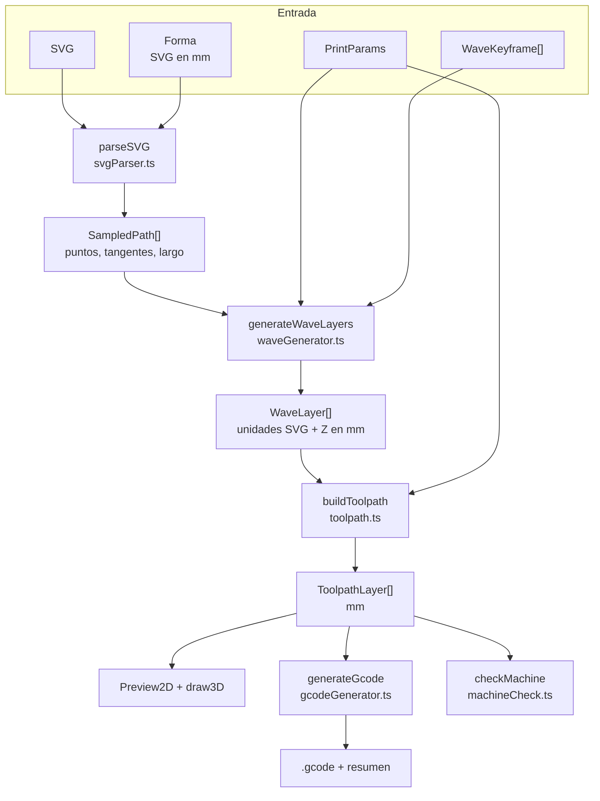

# Arquitectura

BarroCode es una app React + Vite sin servidor. La geometría vive en `src/lib/` (funciones puras, con pruebas), la interfaz en `src/components/` y el espacio *Forma* en `src/shaper/`. Todo el estado está en `App.tsx`.

## De SVG a G-code

La vista 3D, el G-code y la revisión leen la misma trayectoria (`ToolpathLayer[]`). Por eso la vista muestra lo que se exporta, y las pruebas comprueban que coinciden.

## Módulos

| Archivo | Qué hace |
|---|---|
| `lib/svgParser.ts` | Lee el SVG y lo muestrea a lo largo del trazo. |
| `lib/waveGenerator.ts` | Redondea esquinas, calcula la onda N/T/Z con keyframes, aplica escala y giro, y apila las capas. |
| `lib/toolpath.ts` | Pasa a mm, ordena las rutas, calcula los saltos sobre cruces y la rampa de costura. |
| `lib/gcodeGenerator.ts` | Escribe el G-code y calcula a la vez el resumen (tiempo, largos, `E`). |
| `lib/machineProfiles.ts`, `lib/machineCheck.ts` | Perfiles de impresora y revisión antes de exportar. |
| `lib/hopUtils.ts`, `lib/skirtUtils.ts` | Detección de cruces y viajes en arco. |
| `lib/draw3D.ts`, `lib/palette.ts` | Dibujo de la vista 3D y colores tomados del CSS. |
| `lib/keyframeDiff.ts` | Qué cambia entre un keyframe y el anterior. |
| `components/` | Paneles, vista 3D, línea de tiempo, campos numéricos, ayuda. |
| `shaper/` | *Forma*. Se carga aparte la primera vez que se abre y solo entrega un SVG a `App`. |

## Lectura del SVG

`parseSVG` valida el texto con `DOMParser` y quita lo que podría ejecutar código (`<script>`, `<foreignObject>`, atributos `on*`, enlaces `javascript:`). Luego inserta el SVG en un contenedor oculto para medirlo con la API del navegador.

- Lee `path`, `polyline`, `polygon`, `line`, `circle`, `ellipse` y `rect`, y descarta lo que no se dibuja (`defs`, `clipPath`, `mask`, `symbol`, `marker`, `pattern`, `display:none`).
- Separa un `<path>` con varios subtrazados en una ruta por subtrazado (`splitSubpaths`). Si no, el salto entre ellos se imprimiría como un cordón.
- Toma un punto cada `sampleSpacing` con `getPointAtLength`. Donde el trazo gira parejo, la tangente es la cuerda entre los puntos vecinos; en esquinas y extremos se mide a cada lado.
- Pasa los puntos a coordenadas de la raíz con la matriz de transformación del elemento, y los largos con su escala (`lengthScale`). Con escala no uniforme, suma las cuerdas ya transformadas.
- Mueve los puntos para que la esquina del `viewBox` quede en (0, 0). Si la raíz declara `width` o `height` en mm, cm, in, pt, pc o Q, guarda los mm por unidad (`mmPerUnit`).

Cada punto (`SampledPoint`) lleva posición, tangente, normal y largo recorrido (`arcLength`).

## La onda y las capas

`generateWaveLayers` trabaja en unidades SVG; solo la Z está en mm.

1. **Esquinas.** `roundCorners` redondea los tramos más cerrados que `cornerRadius(ampN, ampT, λT)`, unas 1,25 veces la amplitud N. Un contorno cerrado se corta en su punto más suave, para que una esquina en la costura también se redondee.
2. **Costura.** En un contorno cerrado, los dos puntos de la costura comparten tangente (`joinSeamFrame`) y cada onda se ajusta a un número entero de ciclos.
3. **Fase de la capa.** `desfase inicial + capa × desfase por capa`. Con keyframes, ambos se leen al inicio de cada capa, así que una capa tiene una sola fase y cierra en su costura.
4. **Onda.** Para cada punto, la fase avanza con el largo recorrido (`cyc += 2π·ds/λ`) y el punto se desplaza sobre la normal y la tangente; la Z, en altura. Con keyframes, `createKeyframeSampler` interpola los valores a lo largo de la impresión.
5. **Piso en Z.** La capa 0 no baja de su altura; cada punto queda al menos media capa sobre el mismo punto de la capa de abajo. Cada capa guarda en `maxGap` su mayor subida sobre la capa de abajo, para la revisión.
6. **Forma.** Escala y luego giro alrededor del centro de la pieza más `centerX/Y`.
7. **Muro.** Con varias pasadas por capa, cada pasada es la primera desplazada hacia afuera o adentro, y todas forman una sola ruta.

Sin keyframes ni desfase por capa, todas las capas tienen la misma onda (una por sentido con *Alternar por capa*). En ese caso se calcula una vez y solo el piso en Z se repite por capa.

## La trayectoria

`buildToolpath` convierte cada capa a mm (`svgToMM`): el centro de las rutas activas va a *Posición X / Y*.

- Ordena las rutas de cada capa por cercanía, empezando donde terminó la capa anterior.
- Busca los cruces de cada capa con una grilla espacial (`findCrossings`) y los reutiliza cuando una capa repite el recorrido de una de las dos anteriores. En cada cruce, la segunda pasada sube en parábola (`hopAtArc`).
- Con *Transición Z suave*, cada contorno cerrado sube una capa durante su último *Arco de transición*, imprimiendo, y termina donde empieza la capa siguiente.

Cada punto (`ToolpathPoint`) lleva su Z final: altura de la capa + onda Z + salto.

## El G-code

`generateGcode(toolpath, params, keyframes)` escribe:

1. El encabezado, con la máquina, la caja de la pieza, todos los parámetros y los keyframes.
2. La plantilla de inicio, el preámbulo (`G21`, `G90`, `M82`, `G92 E0`), la pausa y el cebado.
3. Cada capa, con marcas para los visores de PrusaSlicer y Cura (`;LAYER_CHANGE`, `;LAYER:n`).
4. Entre rutas, un viaje 2 mm por encima de lo más alto impreso, en arco alrededor de la capa si es largo. Entre capas, si la siguiente empieza cerca, un tramo continuo que sube mientras extruye; si no, un viaje.
5. El final: subida, plantilla de fin y apagado.

`E` es absoluta y acumula el largo 3D de cada movimiento por `ePerMM` (en arcilla, el multiplicador). Solo retrocede en las retracciones de filamento, que el movimiento siguiente recupera. Con `generateE` desactivado no se escribe `E`.

Cada línea `G1` pasa por `move`, que lleva la cuenta del tiempo, los largos y la `E` con los mismos valores redondeados que escribe. `summarizeGcode` vuelve a leer un programa y solo lo usan las pruebas, para comprobar esa cuenta.

## Recalcular sin trabarse

`App.tsx` guarda las capas y la trayectoria en `useMemo`, con los campos que cada etapa lee (`WAVE_PARAMS`, `TOOLPATH_PARAMS`). Cambiar la velocidad no recalcula la geometría. `paramDeps.test.ts` falla si una etapa empieza a leer un campo que no está en su lista.

El G-code se genera 400 ms después del último cambio. Cambiar el espaciado de muestra vuelve a leer el SVG 300 ms después del último cambio.

La vista 3D dibuja en tres planos: fondo, geometría y primer plano. Mientras se recorre la línea de tiempo, la geometría se copia de una imagen guardada y solo se redibujan el extrusor y los keyframes. Mientras la cámara se mueve, dibuja uno de cada cuatro puntos.

## Pruebas

`src/lib/__tests__/` y `src/shaper/lib/__tests__/`, con Vitest. Cubren las funciones puras: que el G-code no extruya en saltos largos ni baje sobre la pieza, que los viajes pasen por encima de lo impreso, que el G-code coincida con la trayectoria de la vista, tres archivos `.gcode` de referencia, la onda, los keyframes, la rotación, la revisión de máquina y la geometría de *Forma*. `svgParser` necesita el DOM y solo tiene pruebas de `splitSubpaths`; lo demás se comprueba en Chromium.
