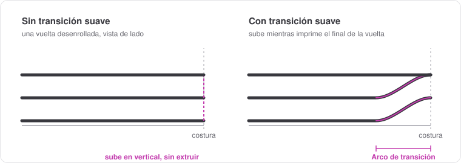

# Notas de fabricación

Las decisiones de BarroCode que vienen de imprimir con arcilla, y por qué se tomaron. Para usar cada opción, ver la [guía de uso](usage.md).

## Principios

- El flujo de arcilla no se corta. No hay retracciones: cortar y retomar el flujo deja huecos y burbujas.
- La boquilla no cruza la pieza en línea recta sobre material fresco.
- Lo que se ve en la vista 3D es lo que se imprime, transiciones incluidas.
- Escala, origen, altura de la primera capa y extrusión se calibran a mano para cada máquina.

## Unión entre capas

Con *Transición Z suave*, cada contorno cerrado sube a la capa siguiente durante el último tramo de la vuelta (el *Arco de transición*), mientras imprime. Termina justo donde empieza la capa siguiente, así que no hay una subida vertical en la costura.



- Cada rampa queda sobre la rampa de la capa de abajo, así que el cordón conserva su altura. Solo la cola de la primera capa se despega de la cama, hasta una altura de capa.
- Con *Alternar por capa* no hay rampa: la capa siguiente empieza encima de ella.
- Si la capa siguiente empieza en otro lugar (trazos abiertos, onda Z, desfase por capa), el hueco se cubre con un tramo continuo que interpola XY y sube Z mientras extruye. Solo si ese hueco es menor que el *Arco de transición*; si no, la boquilla se levanta y viaja. Sin ese límite, un trazo abierto extruiría un cordón de vuelta a través de toda la pieza en cada cambio de capa.

## Saltos sobre los cruces

Si *Altura de salto* es mayor que 0, BarroCode busca dónde la ruta se cruza a sí misma en la capa y, en la segunda pasada, sube la boquilla en parábola sobre el cordón que ya está. La extrusión no se detiene.

Pendiente de comprobar en una impresión: el cruce recibe dos cordones por capa, y la primera pasada de la capa siguiente cruza a la altura de ese cordón doble, sin espacio. Si se confirma, la solución es reducir o anular `E` dentro del salto.

## Desplazamientos

Entre rutas, la boquilla sube 2 mm sobre lo más alto impreso hasta ese momento (incluidos saltos y onda Z) y baja a la Z real de inicio de la ruta siguiente. Si el desplazamiento es más largo que el *Umbral arco desvío*, rodea la pieza en un arco alrededor del centro de la capa en vez de cruzarla.

Al terminar, la boquilla sube 10 mm sobre la pieza o sobre la Z de seguridad, la que sea más alta, para no atravesar una pieza alta.

## Esquinas y costura

La onda desplaza la boquilla sobre la normal del trazo. En una esquina la normal gira de golpe: hacia adentro la onda se enrolla en bucles, hacia afuera salta. Por eso BarroCode redondea antes de ondular toda curva más cerrada de lo que la onda puede seguir, con un radio de unas 1,25 veces la amplitud N.

El costo es que las puntas agudas pierden largo: una punta de 30° pierde unos 15 mm con amplitud 3 mm. La alternativa, atenuar la onda cerca de la punta en vez de redondearla, está pendiente de decidir.

En un contorno cerrado, cada onda entra un número entero de veces en la vuelta, así que se encuentra consigo misma en la costura. Sin ese ajuste, el final quedaba hasta dos amplitudes al costado del inicio, un escalón en cada capa.

## Onda vertical

Con *Amplitud Z*, la boquilla sube y baja dentro de la capa. Dos límites protegen la pieza:

- La primera capa no baja de su altura, para no chocar con la cama.
- Cada punto queda al menos media capa sobre el mismo punto de la capa de abajo, para no aplastarla.

El límite opuesto no se aplica: con desfase por capa, una cresta puede quedar sobre un valle de la capa de abajo y el cordón caer al aire. La revisión avisa cuando la distancia pasa de 1,5 alturas de capa, pero no cambia la onda.

## Escala y unidades

Si el SVG declara su tamaño en unidades físicas (`width="100mm"`), se imprime a ese tamaño. Si no, 1 unidad SVG = 1 mm. Para un dibujo en píxeles a 96 dpi, el factor de escala es `0.2645`. Mide siempre la caja de la pieza (*Cotas* en la vista 3D) antes de imprimir.

## Extrusión

```text
E += largo del movimiento × multiplicador
```

`E` sigue el largo real de cada movimiento, también cuando sube o baja. Sirve para la mayoría de las bombas y tornillos de arcilla, pero cada máquina necesita su multiplicador: calíbralo con una pieza de prueba y velocidades bajas.

Lo que falta: con onda Z, el espacio entre capas varía entre la mitad y más de una vez y media la altura de capa, y `E` no lo compensa. Escalar `E` por ese espacio está en [pendientes](../pendientes.md) (NP-0a).
