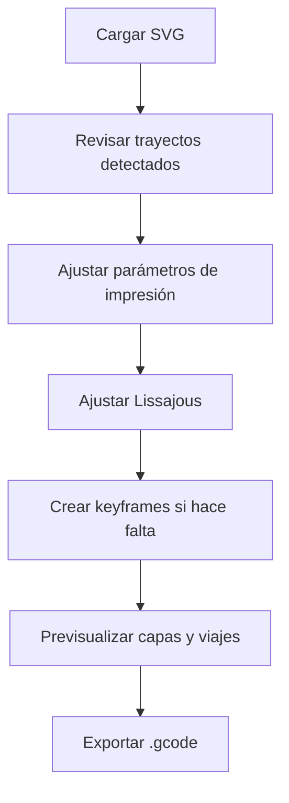

# Uso De BarroCode

Esta guía describe el flujo de uso de BarroCode desde la carga del SVG hasta la exportación del G-code.

## Flujo General

## 1. Cargar Un SVG

Arrastra un archivo SVG al área de carga o haz clic en ella.

Elementos soportados:

- `<path>`
- `<polyline>`
- `<polygon>`
- `<line>`
- `<circle>`
- `<ellipse>`
- `<rect>`

Si no tienes un archivo a mano, usa el navegador de muestras integrado: cuatro SVGs geométricos están embebidos directamente en la aplicación. Las flechas `‹` / `›` cambian de muestra y el clic en la miniatura la carga.

## 2. Revisar Trayectos

Cada elemento geométrico detectado aparece en **Trayectos SVG**.

Puedes:

- activar o desactivar trayectos individuales;
- sobrescribir amplitud normal/tangente por trayecto;
- sobrescribir longitud de onda normal/tangente por trayecto.

Si un override queda vacío, BarroCode usa el valor global.

## 3. Parámetros De Impresión

El panel izquierdo agrupa los parámetros en tres bloques plegables: **Pieza** (capas, escala y posición, centro y escala), **Trayecto** (dirección, unión de capas, z-hop, desplazamientos, muestreo) y **Máquina** (velocidades, extrusión, calibración Z, arcilla). Un bloque plegado muestra un resumen de sus valores clave, y el estado de cada bloque se recuerda entre sesiones.

| Parámetro | Efecto |
|---|---|
| **Espaciado de muestras** | Densidad de muestreo del camino en unidades SVG. Menor valor produce una onda más suave y más puntos. |
| **Altura de capa** | Incremento Z entre capas apiladas. |
| **Número de capas / Altura total** | Define cuántas capas generar, directamente o derivadas desde altura total. |
| **Offset Z de boquilla** | Se suma al Z de cada capa para calibrar la primera capa. |
| **Z de seguridad** | Altura de desplazamiento al inicio y tras el cebado. Al terminar, la boquilla sube 10 mm sobre esta altura o sobre la pieza, la que sea mayor. |
| **Factor de escala** | Convierte unidades SVG a mm. Usa `1` si el SVG está en mm; usa `0.2645` para píxeles a 96 dpi. |
| **Origen X / Y** | Desplaza toda la impresión sobre la cama. |
| **Invertir Y** | Espeja el eje Y para convertir coordenadas SVG, que crecen hacia abajo, a coordenadas de impresora. |
| **Velocidad de impresión / desplazamiento** | Define avances en mm/min. |
| **Generar valores E** | Incluye la columna de extrusión `E`. Desactívalo para salida solo de movimiento. |
| **Multiplicador de extrusión** | Unidades `E` por mm de desplazamiento. Ajustar según bomba, presión o tornillo sin fin. |
| **Transición Z suave** | Conecta una capa con la siguiente con movimiento continuo, sin retracción ni levantamiento. |
| **Arco de transición** | Longitud en mm durante la transición entre capas. |
| **Dirección alternada** | Invierte capas impares para reducir deriva direccional. |
| **Cerrar trayecto** | Agrega retorno al inicio de cada trayecto. |
| **Pausa al inicio** | Inserta `G4` en la primera posición para estabilizar el flujo de arcilla. |
| **Movimiento de cebado** | Extruye una línea corta antes de la impresión principal. |

## 4. Parámetros De Lissajous

| Parámetro | Efecto |
|---|---|
| **Amplitud N** | Semi-amplitud lateral, sobre la normal del trayecto. |
| **Amplitud T** | Semi-amplitud adelante/atrás, sobre la tangente. |
| **Longitud de onda N / T** | Longitud de arco de un ciclo completo de onda. |
| **Delta** | Diferencia de fase entre N y T. `0°` tiende a línea; `90°` tiende a elipse cuando las longitudes de onda coinciden. |
| **Offset de fase** | Fase inicial de la onda. |
| **Desfase por capa** | Fase extra aplicada por capa para crear torsión o comportamiento helicoidal. |

Los preajustes aplican combinaciones de amplitud, longitud de onda y fase con una miniatura de la figura local resultante.

## 5. Keyframes

La línea de tiempo permite anclar parámetros de Lissajous en posiciones específicas de la trayectoria.

1. Mueve el extrusor de la línea de tiempo al punto deseado.
2. Haz clic en **⊕ Añadir**, en el **+** punteado del carril de keyframes o pulsa `K`. El keyframe toma la onda que se ve en ese punto y queda seleccionado.
3. Con un keyframe seleccionado, el panel derecho edita **su** onda (amplitudes, longitudes de onda, delta, Z); el encabezado *Editando Keyframe N %* lo indica. La franja inferior edita su posición, escala y centro.
4. Pulsa **OK** o `Esc` para terminar; `Supr` elimina el keyframe seleccionado. Cambia de keyframe con **‹ ›** o haciendo clic en su rombo; arrástralo para moverlo.

Con keyframes y ninguno seleccionado, los campos de onda del panel derecho quedan bloqueados: la onda la definen los keyframes. *Fase* sigue siendo global.

Los keyframes tienen su propio carril sobre la línea de tiempo; un clic en el carril mueve el extrusor. Entre keyframes, BarroCode interpola linealmente: el carril lo muestra como un tramo liso (resaltado el tramo donde está el extrusor). Antes del primer keyframe y después del último los valores se mantienen, y el tramo aparece rayado.

## 6. Previsualización

La vista global muestra:

- líneas coloreadas por capa;
- transiciones entre capas;
- Z-hop sobre cruces;
- viajes concéntricos cuando no hay soft join;
- posición virtual del extrusor;
- cubo de orientación X/Y/Z.

El encabezado resume la impresión: tiempo estimado (a velocidad programada, sin aceleraciones, incluyendo desplazamientos, cebado y pausas) y tamaño de la pieza en mm. Al pasar el cursor muestra longitudes de impresión y desplazamiento, E total y número de puntos.

| Control | Acción |
|---|---|
| Arrastrar con botón izquierdo | Pan |
| Arrastrar con botón derecho | Rotar azimut/elevación |
| Rueda del mouse | Zoom |
| **Ajustar** | Encuadre automático |
| **Iso / Planta / Frente** | Vistas predefinidas, con encuadre |
| Slider de capas (borde derecho) | Muestra hasta la capa elegida; **Sola** deja solo esa capa en color y las inferiores en gris |

### Atajos de teclado

| Tecla | Acción |
|---|---|
| `←` / `→` | Mueve el extrusor 1 % (con `Shift`, 0,1 %) |
| `K` | Añade un keyframe en el extrusor, o selecciona el que ya está ahí |
| `Esc` / `Supr` | Suelta / elimina el keyframe seleccionado |
| `G` | Alterna Trayectoria / G-code |
| `?` | Abre la ayuda |

### Sesión

BarroCode guarda la sesión en el navegador (SVG, parámetros, keyframes y estado de cada trayecto) un segundo después de cada cambio. Al volver a abrir la app aparece **Sesión anterior** con *Restaurar* o *Descartar*. Descartar el SVG con la ✕ también borra la sesión guardada.

## 7. Exportar

Haz clic en **Descargar .gcode**. El nombre del archivo se deriva del SVG cargado, por ejemplo `mi-vasija.gcode`.
