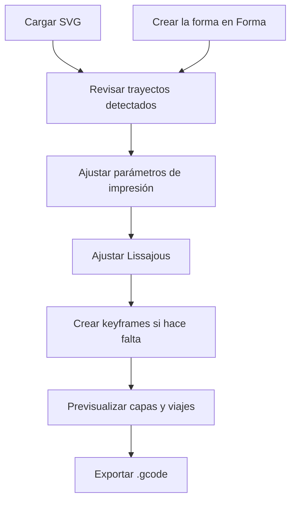

# Uso De BarroCode

Esta guía describe el flujo de uso de BarroCode desde la carga del SVG hasta la exportación del G-code.

## Flujo General

## 1. Cargar Un SVG

Arrastra un archivo SVG sobre la ventana o usa **Cargar SVG** en el panel izquierdo.

Elementos soportados:

- `<path>`
- `<polyline>`
- `<polygon>`
- `<line>`
- `<circle>`
- `<ellipse>`
- `<rect>`

Si no tienes un archivo a mano, usa el navegador de muestras integrado: ocho SVGs geométricos están embebidos directamente en la aplicación. Las flechas `‹` / `›` cambian de muestra y el clic en la miniatura la carga.

### O crear la forma en *Forma*

El selector **Forma · Impresión**, arriba del panel izquierdo, cambia de espacio de trabajo. *Forma* dibuja la línea central de la pieza ya en milímetros, sin pasar por otro programa:

- **Familias**: *Lóbulos* (número, profundidad, agudeza), *Polígono* (lados, estrella, radio de esquina en mm) y *Superfórmula* (m, n1, n2, n3). Debajo, **Diámetro exterior** (dos veces la distancia del centro al punto más lejano), **Giro**, **Costura** (el ángulo donde empieza y termina cada capa) y **Sentido horario**.
- **Descubrir** (barra superior): nueve variaciones de la familia. Clic adopta una; **Más como esta** sortea cerca de la forma actual; **Otra tanda**, en todo el rango. Con nodos (editados o importados), deja los nodos y vuelve a la familia; `Ctrl+Z` los recupera.
- **Imprimibilidad**: marca en rojo los tramos más cerrados de lo que la onda de *Impresión* puede seguir y propone cómo arreglarlo. **Onda** (barra superior) dibuja la franja que barre la onda: donde dos franjas se tocan, las paredes chocarán.
- **Editar puntos**: convierte la forma en nodos. Arrastra un nodo o las asas del elegido; doble clic en la línea añade un nodo; `Supr` lo borra. Con **Simetría**, cada cambio se repite en todas las repeticiones. El panel muestra el nodo elegido y la lista de comandos del trazado. **Volver a la familia**, arriba del panel, deja los nodos.
- **Importar**: **Abrir en Forma** (junto al nombre del archivo, en *Impresión*) o **Abrir SVG…** traen los contornos cerrados de un SVG como nodos, al tamaño que se imprimen. Los trazados abiertos quedan fuera.
- **Enviar a impresión** carga la forma en *Impresión* con el factor de escala en 1; **Editar forma** vuelve a ella.

**Restablecer**, junto al selector *Forma · Impresión*, vuelve a la forma inicial (lóbulos, sin nodos). En *Forma*, `Ctrl+Z` deshace y `Ctrl+Shift+Z` rehace (en *Impresión* no hay deshacer). La forma se guarda en el navegador y vuelve al abrir la app.

## 2. Revisar Trayectos

Cada elemento geométrico detectado aparece en **Trayectos SVG**. Un `<path>` con varios subtrazados (un contorno con agujero, por ejemplo) aparece como un trayecto por subtrazado, con el nombre del original seguido de `-1`, `-2`…

Puedes:

- activar o desactivar trayectos individuales;
- sobrescribir amplitud normal/tangente por trayecto;
- sobrescribir longitud de onda normal/tangente por trayecto.

Si un override queda vacío, BarroCode usa el valor global.

## 3. Parámetros De Impresión

El panel izquierdo agrupa los parámetros de la pieza en dos pestañas: **Pieza** (capas, resolución, escala, centro, escala y giro) y **Trayecto** (dirección, unión de capas, z-hop, desplazamientos). Lo que depende de la impresora está en el espacio **Máquina** (ver *3b*). La pestaña activa se recuerda entre sesiones. Ambos paneles laterales se pueden plegar; con menos de 1280 px de ancho solo queda uno abierto.

| Parámetro | Efecto |
|---|---|
| **Espaciado de muestra** (Pieza › Resolución) | Distancia entre los puntos que se toman del trazo, en unidades SVG (mm cuando la escala es 1). Lo justo son unos 10 puntos por ciclo de la onda más corta: menos y la onda sale quebrada, más y el G-code pesa más y cada cambio tarda en recalcularse. Debajo, el panel muestra los puntos por ciclo y sugiere un valor (entre 0,25 y 2,5 mm). |
| **Altura de capa** | Incremento Z entre capas apiladas. |
| **Número de capas / Altura total** | Define cuántas capas generar, directamente o derivadas desde altura total. |
| **Factor de escala** | Convierte unidades SVG a mm. Si el SVG declara su tamaño en unidades físicas (`width="100mm"`, `pt`, `in`…), se ajusta solo al cargarlo para imprimir a tamaño real, y el botón *Usar tamaño real* lo restablece. Si no tiene unidades, usa `1` cuando las coordenadas estén en mm o `0.2645` para píxeles a 96 dpi. |
| **Invertir Y** | Espeja el eje Y para convertir coordenadas SVG, que crecen hacia abajo, a coordenadas de impresora. |
| **Transición Z suave** | Conecta una capa con la siguiente con movimiento continuo, sin retracción ni levantamiento. En rutas cerradas la boquilla sube a la capa siguiente mientras recorre el final de la vuelta, en vez de subir en vertical en la costura. |
| **Arco de transición** | Largo en mm del tramo final de cada ruta cerrada en el que se sube a la capa siguiente. Si es mayor que el perímetro, la subida ocupa toda la vuelta. No se aplica con *Dirección alternada*. |
| **Dirección alternada** | Invierte capas impares para reducir deriva direccional. |
| **Cerrar trayecto** | Agrega retorno al inicio de cada trayecto. |

## 3b. Máquina

El tercer espacio, **Máquina** (selector de arriba del panel izquierdo), reúne lo que depende de la impresora. Se guarda aparte (`barrocode.machine`) y se conserva al cargar otro SVG o restaurar una sesión. La vista 3D dibuja la cama bajo la pieza, con su origen X0 Y0; el borde se pone en rojo y discontinuo si algo se sale. El panel derecho es la **Revisión previa**: errores, avisos y lo que está bien, con un resumen de tiempo, material, caja y tamaño del archivo.

| Parámetro | Efecto |
|---|---|
| **Perfil** | Rellena la máquina de una vez y centra la pieza en la cama. Arcilla: origen al centro, origen en esquina, Delta WASP 2040 Clay. Filamento: Creality K1 / K1C, K1 Max, Ender-3 V3, V3 KE, V3 SE, Ender-3 S1; Bambu Lab A1 mini, A1, P1S / X1C; Prusa MK4S, CORE One, MINI+; Elegoo Neptune 4 Pro; Anycubic Kobra 3; Sovol SV06; Voron 2.4 (350). Son cifras de catálogo y perfiles de la comunidad, sin verificar en máquina. Cambiar un valor pasa a *Personalizado*. |
| **Material** | *Arcilla*: E es el multiplicador de la bomba y nunca hay retracción. *Filamento*: E es el volumen del cordón sobre la sección del filamento, con retracción, ventilador y temperaturas; las velocidades se muestran en mm/s. |
| **Firmware** | Marlin, Klipper, Prusa, Bambu Lab o RepRap. Decide cómo se escribe la aceleración (`M204` o `SET_VELOCITY_LIMIT`) y qué avisos da la revisión. |
| **Cama** | Rectangular (ancho X, fondo Y) o redonda (diámetro), y altura Z. La subida final no pasa de esa altura. |
| **Origen de la máquina** | Dónde está X0 Y0: en la esquina delantera izquierda (casi todas las cartesianas) o en el centro (deltas). |
| **Colocar la pieza por** | *Su centro* pone el centro de la pieza en *Posición X / Y*. *Su esquina inf. izq.* pone la esquina inferior izquierda del rectángulo que ocupa la pieza a *Margen X / Y* del origen. *Centrar en la cama* usa *Su centro* con el centro de la cama. |
| **Boquilla / Ancho de cordón** | Con la altura de capa dan el volumen extruido (filamento) y la revisión de la capa: en filamento, más del 80 % de la boquilla es un error; en arcilla, un aviso. Menos del 25 % avisa en los dos. |
| **Diámetro de filamento / Flujo / Caudal máximo** | Filamento. El caudal máximo es lo que el fusor alcanza a fundir (mm³/s); la revisión avisa si ancho × capa × velocidad lo supera. |
| **Generar valores E / Multiplicador** | Incluye la columna `E`. El multiplicador (arcilla) son unidades `E` por mm; ajústalo a la bomba, la presión o el tornillo. |
| **Temperaturas / Ventilador** | Filamento. Las temperaturas entran en la plantilla de inicio (`{nozzleTemp}`, `{bedTemp}`); el ventilador se apaga al empezar (`M107`) y se enciende en la capa indicada (`M106`). |
| **Velocidades** | Impresión, primera capa (0 = la de impresión) y desplazamiento. |
| **Tiempo mín. por capa** | Las capas que tardarían menos se imprimen más despacio, para enfriar (filamento) o asentarse (arcilla). 0 = desactivado. |
| **Aceleración** | 0 deja la de la máquina. |
| **Retracción** | Filamento: mm que se recogen antes de cada desplazamiento entre trayectos y se devuelven al llegar. |
| **Desplazamiento Z** | Altura de la primera capa: se suma al Z de cada capa. En filamento suele ser una altura de capa; la revisión da error si queda en Z 0. |
| **Z de seguridad** | Altura de desplazamiento al inicio y tras el cebado. Al terminar, la boquilla sube 10 mm sobre esta altura o sobre la pieza, sin pasar la altura de la máquina. |
| **Pausa al inicio / Cebado** | Arcilla. `G4` en la primera posición, y una línea corta paralela a X a 10 mm de la primera capa (debajo, o encima si debajo quedaría en Y negativa). |
| **Inicio y fin** | G-code antes y después del programa. Variables: `{nozzleTemp}`, `{bedTemp}`, `{bedX}`, `{bedY}`, `{bedZ}`, `{firstLayerZ}`, `{topZ}`, `{parkZ}`, `{minX}`, `{maxX}`, `{minY}`, `{maxY}`. Una variable desconocida queda tal cual y la revisión lo marca como error. Sin plantilla de fin, el programa acaba con `M84`. |
| **Adaptar a la boquilla** | En la revisión: ajusta altura de capa, ancho de cordón, onda N (si no hay keyframes), espaciado de muestra y, con filamento, el desplazamiento Z a la boquilla. |

## 4. Parámetros De Lissajous

| Parámetro | Efecto |
|---|---|
| **Amplitud N** | Semi-amplitud lateral, sobre la normal del trayecto. Las esquinas y curvas más cerradas de lo que la onda puede seguir se redondean con un radio de 1,25 × la amplitud N (más si la onda T es grande), para que la onda no forme bucles hacia dentro ni saltos hacia fuera. Con amplitud 0 la trayectoria conserva las esquinas tal como están. |
| **Amplitud T** | Semi-amplitud adelante/atrás, sobre la tangente. |
| **Longitud de onda N / T** | Longitud de arco de un ciclo completo de onda. En un trayecto cerrado se ajusta levemente para que entre un número entero de ciclos y la onda cierre sin escalón en la costura (de 20 a 19,97 mm en un contorno de 3,5 m). |
| **Delta** | Diferencia de fase entre N y T. `0°` tiende a línea; `90°` tiende a elipse cuando las longitudes de onda coinciden. |
| **Offset de fase** | Fase inicial de la onda. |
| **Amplitud Z** | Oscilación vertical de la boquilla. La primera capa no baja de su altura y cada punto queda al menos media altura de capa sobre la capa anterior: con amplitudes grandes o desfase por capa, los valles se aplanan en vez de chocar. |
| **Desfase por capa** | Fase extra aplicada por capa para crear torsión o comportamiento helicoidal. |

Los preajustes aplican combinaciones de amplitud, longitud de onda y fase con una miniatura de la figura local resultante.

## 5. Keyframes

La línea de tiempo permite anclar parámetros de Lissajous en posiciones específicas de la trayectoria.

1. Mueve el extrusor de la línea de tiempo al punto deseado.
2. Haz clic en **⊕ Añadir**, en el **+** punteado de la línea de tiempo o pulsa `K`. El keyframe toma la onda que se ve en ese punto y queda seleccionado.
3. Con un keyframe seleccionado, el panel derecho edita **su** onda (amplitudes, longitudes de onda, delta, Z y fase); el encabezado *Editando Keyframe N %* lo indica. La franja inferior edita su posición, giro, escala, centro y transición.
4. Pulsa **OK** o `Esc` para terminar; `Supr` elimina el keyframe seleccionado. Cambia de keyframe con **‹ ›**, con `←` / `→` o haciendo clic en su rombo; arrástralo para moverlo. Al arrastrar se ajusta al inicio de capa (la costura); con `Alt` se mueve libre.

Con keyframes y ninguno seleccionado, el panel derecho muestra la onda interpolada en el extrusor. Si cambias un valor de la onda, se crea un keyframe ahí con ese cambio (o se edita el que ya está bajo el extrusor).

Cada keyframe se muestra como un rombo numerado de color, con el mismo número y color en la línea de tiempo, la vista 3D y los paneles. La línea de tiempo indica la capa y la altura bajo el extrusor ("capa 23 · 34.5 mm"). Entre keyframes, BarroCode interpola en línea recta; un keyframe con *Transición · Suave* se dibuja redondo y sus valores llegan y salen sin quiebre en la pared.

*Borrar todos* pide un segundo clic. Al borrar el último keyframe, su onda, centro, escala y giro pasan a ser los valores globales, así que la pieza no cambia. Al cargar otro SVG, los keyframes conservan la onda y pierden centro, escala y giro.

**Giro:** cada keyframe puede girar la pieza alrededor de su centro, en grados, antihorario visto desde arriba. El giro se aplica después de la escala y se interpola sin atajos: de 0° a 360° la pieza da una vuelta completa a lo largo de su altura (torsión). Una torsión fuerte desplaza cada capa respecto a la de abajo, más cuanto más lejos del centro, y el cordón puede quedar en voladizo; BarroCode no lo limita, así que conviene revisarlo en la vista 3D.

## 6. Previsualización

La vista global muestra:

- líneas coloreadas por capa;
- transiciones entre capas;
- Z-hop sobre cruces;
- viajes concéntricos cuando no hay soft join;
- posición virtual del extrusor;
- cubo de orientación X/Y/Z.

El encabezado resume la impresión: tiempo estimado (a velocidad programada, sin aceleraciones, incluyendo desplazamientos, cebado y pausas) y tamaño de la pieza en mm. Al pasar el cursor muestra longitudes de impresión y desplazamiento, E total y número de puntos.

| Control | Acción |
|---|---|
| Arrastrar con botón izquierdo | Pan |
| Arrastrar con botón derecho | Rotar azimut/elevación |
| Rueda del mouse | Zoom |
| **Ajustar** | Encuadre automático |
| **Iso / Planta / Frente** | Vistas predefinidas, con encuadre |
| Slider de capas (borde derecho) | Muestra hasta la capa elegida; el botón *Aislar capa* (icono de capas, debajo) deja solo esa capa en color y las inferiores en gris |

Las vistas y el encuadre se animan; al soltar una rotación la cámara sigue un instante por inercia. El azimut y la elevación aparecen junto al cubo de orientación solo mientras la cámara gira.

### Campos numéricos y sliders

| Gesto | Acción |
|---|---|
| Rueda sobre un número | Sube o baja un paso (con `Shift`, un paso fino) |
| Arrastrar la etiqueta de un número | Desliza el valor a izquierda o derecha (con `Shift`, en pasos finos) |
| Arrastrar un slider de la onda | Se pega al valor por defecto (la marca en la pista) y muestra el valor sobre el control |

El centro de pivote (de la escala y el giro) se mide desde el centro geométrico de la pieza: 0, 0 es el centro de la pieza. El icono de restablecer junto al título (*Centrar en la pieza*) lo devuelve ahí; *Escala* y *Giro* tienen el mismo icono para volver a 1× y 0°. Los campos del centro de pivote avanzan de 5 en 5 mm (1 mm con `Shift`). La vista 3D gira alrededor del centro de la pieza.

### Atajos de teclado

| Tecla | Acción |
|---|---|
| `←` / `→` | Mueve el extrusor 1 % (con `Shift`, 0,1 %) |
| `K` | Añade un keyframe en el extrusor, o selecciona el que ya está ahí |
| `Esc` / `Supr` | Suelta / elimina el keyframe seleccionado |
| `G` | Abre o cierra el panel de G-code |
| `?` | Abre la ayuda |
| `Ctrl+Z` / `Ctrl+Shift+Z` | En *Forma*: deshace / rehace |
| `Supr` / `Esc` | En *Forma*: borra / suelta el nodo elegido (o cierra *Descubrir*) |

### Sesión

BarroCode guarda la sesión en el navegador (SVG, parámetros, keyframes y estado de cada trayecto) un segundo después de cada cambio. Al volver a abrir la app aparece **Sesión anterior** con *Restaurar* o *Descartar*. Descartar el SVG con la ✕ también borra la sesión guardada. La forma de *Forma* se guarda aparte y vuelve sola.

## 7. Exportar

Haz clic en **Descargar** en la barra superior. El panel **G-code** de la misma barra muestra el archivo (las primeras 1500 líneas) y permite copiarlo entero. El nombre del archivo se deriva del SVG cargado, por ejemplo `mi-vasija.gcode`.
