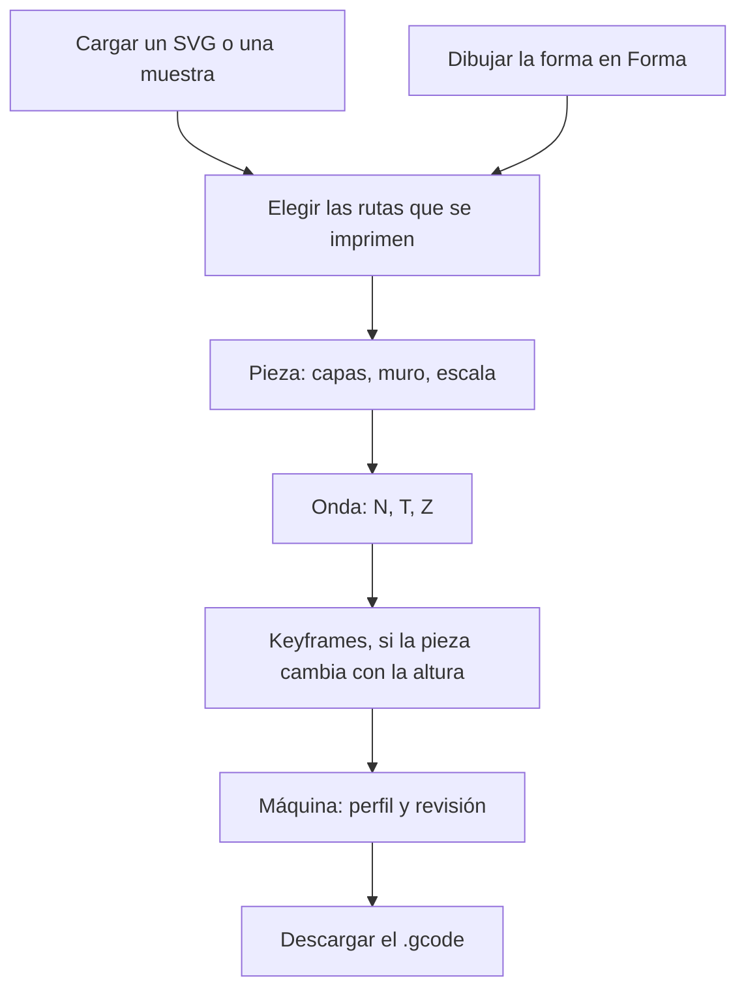
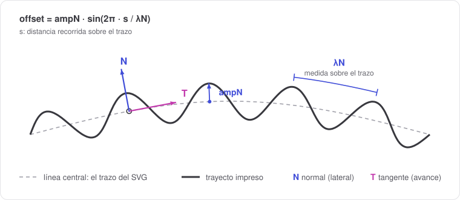

# Guía de uso

Cómo pasar de un dibujo a un archivo `.gcode` con barrocode, y qué hace cada parámetro.

La app tiene tres espacios de trabajo. Se cambian con el selector de arriba del panel izquierdo, en cualquier orden:

| Espacio | Para qué |
|---|---|
| **Forma** | Dibujar la línea central de la pieza, en mm. Es opcional. |
| **Impresión** | Rutas, capas, onda y keyframes. Es donde se diseña la pieza. |
| **Máquina** | La impresora: cama, boquilla, velocidades, plantillas. Muestra la revisión antes de exportar. |

## 1. Cargar la pieza

Arrastra un archivo SVG sobre la ventana o pulsa **Cargar SVG** en el panel izquierdo. barrocode lee estos elementos: `<path>`, `<polyline>`, `<polygon>`, `<line>`, `<circle>`, `<ellipse>` y `<rect>`.

No se imprime lo que el SVG no dibuja: el contenido de `<defs>`, `<clipPath>`, `<mask>`, `<symbol>`, `<marker>` y `<pattern>`, ni los elementos con `display:none`. Los elementos con `visibility:hidden` sí se imprimen; bórralos antes de exportar el SVG.

Sin archivo a mano, usa las muestras: ocho dibujos y cinco polígonos básicos. Las flechas `‹` `›` cambian de muestra y un clic en la miniatura la carga. Cada muestra mide 15 cm en su lado mayor y se carga con 15 cm de alto (el número de capas se ajusta a tu altura de capa).

**Tamaño.** Si el SVG declara su tamaño en unidades físicas (`width="100mm"`, `cm`, `in`, `pt`…), se imprime a ese tamaño. Si no, 1 unidad SVG = 1 mm.

## 2. Forma

*Forma* dibuja la línea central de la pieza directamente en mm, con curvas que la onda puede seguir.

- **Familias.** *Lóbulos* (número, profundidad, agudeza), *Polígono* (lados, estrella, radio de esquina en mm) y *Superfórmula* (m, n1, n2, n3).
- **Tamaño y orientación.** *Diámetro exterior* es dos veces la distancia del centro al punto más lejano. *Giro* rota la forma. *Costura* es el ángulo donde empieza y termina cada capa. *Sentido horario* invierte el recorrido.
- **Descubrir** (barra superior) muestra nueve variaciones de la familia. Un clic adopta una. *Más como esta* busca cerca de la forma actual; *Otra tanda*, en todo el rango.
- **Imprimibilidad** marca en rojo los tramos más cerrados de lo que la onda puede seguir y propone cómo corregirlos. **Onda** (barra superior) dibuja la franja que ocupa la onda: donde dos franjas se tocan, las paredes chocarán.
- **Editar puntos** convierte la forma en nodos. Arrastra un nodo o las asas del nodo elegido. Doble clic en la línea agrega un nodo; `Supr` lo borra. Con *Simetría*, cada cambio se repite en todas las repeticiones. *Volver a la familia*, arriba del panel, descarta los nodos.
- **Importar.** *Abrir SVG…* en *Forma*, o *Abrir en Forma* junto al nombre del archivo en *Impresión*, traen los contornos cerrados de un SVG como nodos, a su tamaño de impresión. Los trazos abiertos no se importan.
- **Enviar a impresión** carga la forma en *Impresión* con factor de escala 1. **Editar forma** vuelve a ella.

En el lienzo, la rueda acerca o aleja alrededor del cursor, y arrastrar el fondo (o con el botón central) desplaza la vista. El botón de encuadre vuelve a la vista inicial.

`Ctrl+Z` deshace y `Ctrl+Shift+Z` rehace. **Restablecer** vuelve a la forma inicial. La forma se guarda en el navegador.

## 3. Rutas SVG

Cada elemento que barrocode encuentra aparece en **Rutas SVG**, con su largo en mm (a la escala SVG→mm, sin la onda). Un `<path>` con varios subtrazados (un contorno con agujero, por ejemplo) se separa en una ruta por subtrazado: `nombre-1`, `nombre-2`…

En cada ruta puedes:

- desactivarla para que no se imprima (la pieza se vuelve a centrar con las demás);
- con la flecha `›`, cambiar su amplitud y longitud de onda N y T. Un campo vacío usa el valor de la onda global.

Con keyframes, los valores por ruta no se aplican y quedan desactivados.

## 4. Pieza

Pestaña **Pieza** del panel izquierdo.

| Parámetro | Qué hace |
|---|---|
| **Altura de capa** | Distancia en Z entre una capa y la siguiente. |
| **Núm. de capas** / **Altura total** | Cuántas capas se apilan, o la altura de la pieza (el número de capas sale de dividirla por la altura de capa). Máximo 500 capas. |
| **Pasadas por capa** (Muro) | Cuántos cordones, uno al lado del otro, forman la pared (1 a 4). Todos repiten la onda con las crestas alineadas. En un contorno cerrado se imprimen uno tras otro y solo el último sube a la capa siguiente; en un trazo abierto van de ida y vuelta. |
| **Separación** | Distancia entre cordones vecinos, en % del ancho de cordón de *Máquina*. Al 100 % se tocan. En los flancos de la onda quedan más juntos que en las crestas. |
| **Afuera / Adentro / Centrado** | Hacia dónde crece la pared desde la línea dibujada. Afuera y adentro dejan el primer cordón sobre la línea; centrado la deja en el medio de la pared. |
| **Espaciado** (Resolución) | Distancia entre los puntos que se toman del trazo, en unidades SVG (mm con escala 1). Conviene tener unos 10 puntos por ciclo de la onda más corta. Debajo, el panel cuenta los puntos por ciclo y sugiere un valor. |
| **Factor de escala** | Convierte unidades SVG a mm. Se ajusta solo con un SVG que declara su tamaño; *Usar tamaño real* lo restablece. Sin unidades, usa `1` si el dibujo está en mm o `0.2645` si está en píxeles a 96 dpi. |
| **Invertir eje Y** | El SVG cuenta Y hacia abajo y casi todas las impresoras hacia arriba. Activado, la pieza sale en la cama como se ve en el dibujo. |
| **Centro** | Punto alrededor del que se escala y gira la pieza, medido desde el centro de la pieza (0, 0 es el centro). Se mueve con los campos o en el recuadro pequeño. *Centrar en la pieza* lo devuelve a 0, 0. |
| **Escala** | Escala de la forma alrededor del centro, igual o distinta en X e Y. No cambia el factor de escala del SVG. |
| **Giro** | Giro de la forma alrededor del centro, en grados, antihorario visto desde arriba. |

## 5. Trayecto

Pestaña **Trayecto** del panel izquierdo.

| Parámetro | Qué hace |
|---|---|
| **Invertir dirección** | La boquilla recorre cada ruta en sentido contrario. |
| **Alternar por capa** | Una capa en un sentido y la siguiente en el otro, así cada capa empieza donde terminó la anterior. La subida a la capa siguiente es vertical. |
| **Cerrar trayecto** | Si una ruta no termina donde empezó, agrega el tramo que la cierra. |
| **Transición Z suave** | La boquilla sigue extruyendo al pasar a la capa siguiente. En un contorno cerrado sube como una rampa al final de la vuelta; en un trazo abierto, solo si la capa siguiente empieza cerca. Desactivada, la boquilla se levanta 2 mm en cada cambio de capa. |
| **Arco de transición** | Largo del tramo final de la vuelta en que la boquilla sube a la capa siguiente. Más largo, rampa más suave. En un trazo abierto, es la distancia máxima a la que puede empezar la capa siguiente para unirlas sin levantar. |
| **Altura de salto** (Z-hop en cruces) | Cuánto sube la boquilla donde la ruta se cruza a sí misma, para no aplastar el cordón que ya está. Solo salta la segunda pasada. 0 = sin saltos. |
| **Radio de cruce** | Distancia a cada lado del cruce en que la boquilla sube y vuelve a bajar, en parábola. |
| **Umbral arco desvío** | Los desplazamientos entre rutas más largos que esto rodean la pieza en arco en vez de cruzarla. Siempre van 2 mm por encima de lo más alto ya impreso. |

## 6. Onda

El panel derecho. Arriba, una figura pequeña muestra la onda que recorre la boquilla, y una línea dice qué se está editando: la onda global, la de un keyframe o la interpolada en el extrusor.

| Parámetro | Qué hace |
|---|---|
| **Preajustes** | Combinaciones listas: Sinusoide, Elipse, Figura 8, Espiral, Trébol y Plano. |
| **Amplitud N** | Cuánto se separa la boquilla de la línea, hacia los lados. Las curvas más cerradas de lo que la onda puede seguir se redondean con un radio de unas 1,25 veces esta amplitud. Con 0, la línea queda tal cual. |
| **Longitud de onda N** | Largo de un ciclo, medido sobre el trazo. En un contorno cerrado se ajusta un poco para que entre un número entero de ciclos y la onda cierre en la costura. |
| **Amplitud T** / **Longitud de onda T** | Lo mismo hacia adelante y atrás, sobre el sentido de avance. |
| **Amplitud Z** / **Longitud de onda Z** / **Fase Z** | Oscilación en altura. La primera capa no baja de su altura y cada punto queda al menos media capa sobre la capa de abajo. Si una cresta queda muy por encima de la capa de abajo, la revisión avisa que el cordón puede caer al aire. |
| **Delta (N respecto a T)** | Desfase entre N y T. Con longitudes iguales, 0° da una línea y 90° una elipse. |
| **Desfase inicial** | Dónde empieza la onda en la primera capa. |
| **Desfase por capa** | Cuánto se corre la onda en cada capa. Produce torsiones y espirales. |

*Restablecer* (junto al título *Onda*) vuelve los valores de la onda a los iniciales. Con un keyframe elegido, solo los de ese keyframe.

## 7. Keyframes

Un keyframe fija la onda, la escala, el giro y el centro en un punto de la impresión. Entre dos keyframes, cada valor pasa de uno a otro.

1. Mueve el extrusor de la línea de tiempo (abajo) al punto que quieras.
2. Pulsa **Keyframe** o `K`. El keyframe toma la onda que se ve en ese punto y queda elegido.
3. Con un keyframe elegido, el panel derecho edita su onda (dice *Editando* con el % y *Keyframe N*). El editor sobre la línea de tiempo edita su centro (con la planta), posición, giro, escala y transición. La pestaña en su borde superior lo oculta y lo vuelve a mostrar.
4. Pulsa **✓ Listo** o `Esc` para terminar. `Supr` borra el keyframe elegido.

Más:

- `←` `→`, los botones `‹` `›` o un clic en un rombo cambian de keyframe. Para mover uno, arrástralo: se ajusta al inicio de la capa más cercana; con `Alt` se mueve libre.
- `D` (o el botón de copia junto a *Keyframe*) copia el keyframe anterior en el extrusor. Sirve para sostener o repetir una onda más arriba.
- Con keyframes y ninguno elegido, el panel derecho muestra la onda en el extrusor. Si cambias un valor, se crea un keyframe ahí.
- *Transición · Suave* hace que los valores lleguen al keyframe y salgan de él sin quiebre en la pared. Un keyframe suave se dibuja redondo.
- La línea de tiempo indica la capa y la altura bajo el extrusor ("capa 23 · 57.5 mm").
- *Borrar todos* pide un segundo clic. Al borrar el último keyframe, sus valores pasan a la onda global y la pieza no cambia.
- Al cargar otro SVG, los keyframes conservan la onda y pierden el centro, la escala y el giro.

**Giro con keyframes.** De 0° a 360°, la pieza da una vuelta completa a lo largo de su altura. Una torsión fuerte desplaza cada capa respecto a la de abajo, más cuanto más lejos del centro, y el cordón puede quedar en voladizo. barrocode no lo limita: revísalo en la vista 3D.

## 8. Máquina

El tercer espacio de trabajo. Lo que pongas aquí se guarda aparte y se mantiene al cargar otro SVG.

La vista 3D dibuja la cama bajo la pieza, con su origen X0 Y0; el borde se pone rojo y punteado si algo se sale. El panel derecho es la **Revisión previa**: errores, avisos y lo que está bien, con el tiempo, el material, la caja y el tamaño del archivo. Dos botones corrigen lo más común: *Centrar en la cama* y *Adaptar a la boquilla*.

En *Impresión*, una marca en la barra superior avisa de los mismos errores (en rojo) y de los avisos sobre la pieza (en gris). Un clic abre la revisión.

| Parámetro | Qué hace |
|---|---|
| **Perfil** | Rellena la máquina de una vez y centra la pieza en la cama. Arcilla: origen al centro, origen en esquina, Delta WASP 2040 Clay. Filamento: Creality, Bambu Lab, Prusa, Elegoo, Anycubic, Sovol y Voron. Son cifras de catálogo, sin probar en cada máquina. Cambiar un valor pasa a *Personalizado*. |
| **Material** | *Arcilla*: `E` es un multiplicador de la bomba y nunca hay retracción. *Filamento*: `E` es el volumen del cordón sobre la sección del filamento, con retracción, ventilador y temperaturas. |
| **Firmware** | Marlin, Klipper, Prusa, Bambu Lab o RepRap. Define cómo se escribe la aceleración y qué avisos da la revisión. |
| **Cama** | Rectangular (ancho y fondo) o redonda (diámetro), y altura. La subida final no pasa de esa altura. |
| **Origen X0 Y0** | Dónde está X0 Y0: en el *Centro* (deltas) o en la *Esquina* delantera izquierda (casi todas las cartesianas). |
| **Colocar por** | *Centro* pone el centro de la pieza en *Posición X / Y*. *Esquina* pone la esquina inferior izquierda de la pieza a *Margen X / Y* del origen. |
| **Boquilla** / **Ancho de cordón** | Con la altura de capa, definen el volumen extruido (filamento) y la revisión de la capa. |
| **Generar valores E** / **Multiplicador** | Incluye la columna `E`. En arcilla, el multiplicador son unidades `E` por mm recorrido: ajústalo a tu bomba, pistón o tornillo. `E` sigue el largo real de cada movimiento, subidas incluidas. |
| **Temperaturas** / **Ventilador** | Filamento. Las temperaturas entran en la plantilla de inicio; el ventilador se enciende en la capa indicada y se apaga al terminar, antes de la plantilla de fin. |
| **Velocidades** | Impresión, primera capa (0 = la de impresión) y desplazamiento. |
| **Tiempo mín. por capa** | Las capas más rápidas que esto se imprimen más despacio, para enfriar o asentarse. 0 = desactivado. |
| **Desplazamiento Z** | Altura de la primera capa. La revisión da error si queda en Z 0. |
| **Z de seguridad** | Altura de los desplazamientos al inicio y después del cebado. |
| **Pausa al inicio** / **Cebado** | Arcilla. Una pausa (`G4`) en la primera posición y una línea corta a 10 mm de la primera capa. |
| **Inicio y fin** | G-code antes y después del programa, con variables: `{nozzleTemp}`, `{bedTemp}`, `{bedX}`, `{bedY}`, `{bedZ}`, `{firstLayerZ}`, `{topZ}`, `{parkZ}`, `{clearZ}`, `{minX}`, `{maxX}`, `{minY}`, `{maxY}`. Una variable desconocida es un error en la revisión. |

Con filamento, el archivo empieza como uno de Creality Print: una miniatura de la pieza (vista isométrica, 96 y 300 px), el tiempo estimado, el filamento usado (largo, volumen y peso con PLA de 1,24 g/cm³) y el número de capas. Así la pantalla de la impresora los muestra. El tiempo es el de la barra superior: a la velocidad programada, sin aceleraciones, así que la impresión real tarda algo más. En el panel de G-code cada miniatura ocupa una sola línea.

Al final del programa, con arcilla, barrocode siempre agrega `M400` (espera el último movimiento), `M107` (apaga la salida auxiliar, por si el tornillo o la válvula de aire cuelgan de ella) y `M84` (apaga los motores, extrusor incluido).

## 9. Vista 3D

La vista dibuja la misma trayectoria que se escribe en el G-code: las capas, las subidas entre capas, los saltos sobre los cruces, los desplazamientos, el extrusor y los keyframes.

La barra superior resume la impresión: tiempo estimado (a la velocidad programada, sin aceleraciones) y tamaño de la pieza. Al pasar el cursor muestra los largos de impresión y desplazamiento, la `E` total y el número de puntos. Si la ventana es angosta, el resumen pasa a dos líneas y algunos botones quedan solo con su ícono.

| Control | Qué hace |
|---|---|
| Arrastrar | Desplaza la vista. |
| Arrastrar con el botón derecho | Gira la cámara. |
| Rueda | Acerca o aleja. |
| Botón de encuadre | Encuadra la pieza. |
| **Isométrica / Planta / Frente** | Vistas fijas. |
| **Color** | Colorea cada capa o usa un solo color. |
| **Cotas** | Muestra el largo, el ancho y el alto de la pieza. |
| Barra de capas (derecha) | Muestra hasta la capa elegida. *Aislar capa*, debajo, deja solo esa capa en color. |

## 10. Exportar

Pulsa **Descargar**. **G-code** abre el archivo en un panel (las primeras 1500 líneas) y permite copiarlo entero. El nombre del archivo empieza con el del SVG y sigue con la altura de capa, el tiempo estimado y la fecha y hora de la descarga: `mi-vasija.svg` con capas de 1,5 mm da `mi-vasija_1.5mm_2h05m_20261106-1432.gcode`. Así dos versiones de la misma pieza no se pisan y se ordenan por fecha.

## Campos numéricos

| Gesto | Qué hace |
|---|---|
| Rueda sobre un número | Sube o baja un paso. Con `Shift`, un paso fino. |
| Arrastrar la etiqueta de un número | Cambia el valor hacia la izquierda o la derecha. Con `Shift`, en pasos finos. |
| Arrastrar un deslizador de la onda | Se pega al valor inicial (la marca en la pista) y muestra el valor encima. |

## Atajos de teclado

| Tecla | Qué hace |
|---|---|
| `←` `→` | Mueve el extrusor 1 % (con `Shift`, 0,1 %). Con un keyframe elegido, salta al vecino. |
| `K` | Agrega un keyframe en el extrusor, o elige el que ya está ahí. |
| `D` | Copia el keyframe anterior en el extrusor. |
| `Esc` / `Supr` | Suelta / borra el keyframe elegido. |
| `G` | Abre o cierra el G-code. |
| `?` | Abre la ayuda. |
| `Ctrl+Z` / `Ctrl+Shift+Z` | En *Forma*: deshace / rehace. |
| `Supr` / `Esc` | En *Forma*: borra / suelta el nodo elegido. |

## Sesión

barrocode guarda la sesión en el navegador (SVG, parámetros, keyframes y rutas) un segundo después de cada cambio. Al volver aparece **Sesión anterior**, con *Restaurar* o *Descartar*. Cerrar el SVG con la ✕ también borra la sesión guardada. La máquina y la forma de *Forma* se guardan aparte y vuelven solas.

## Proyecto

Un proyecto es un archivo `.barrocode.json` con el diseño completo: el SVG, los parámetros, los keyframes, qué rutas se imprimen con sus ajustes propios y la forma de *Forma*. Sirve para guardar una pieza y para compartirla.

- **Proyecto › Guardar**, bajo el nombre del archivo en *Impresión*, lo descarga con el nombre de la pieza.
- **Proyecto › Abrir** lo carga y reemplaza la pieza actual. También puedes arrastrarlo a la ventana.

La máquina no viaja con el diseño. El archivo la guarda como referencia, pero al abrirlo se mantiene tu impresora, con sus velocidades, su ancho de cordón y su extrusión. Revisa *Máquina* antes de imprimir un proyecto ajeno.

Un proyecto sin SVG, solo con una forma, se abre en *Forma*.
